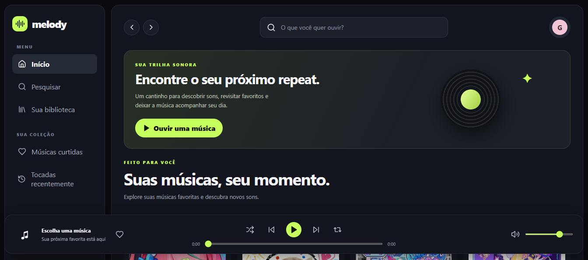

# 🎵 Melody

O **Melody** é uma aplicação web de reprodução musical inspirada na interface de plataformas de streaming, como o Spotify.

Desenvolvido com **HTML, CSS e JavaScript**, o projeto oferece uma experiência interativa para explorar músicas, gerenciar favoritos e controlar a reprodução de áudio, com uma interface moderna e responsiva.

## ✨ Funcionalidades

- Reprodução e pausa de músicas
- Navegação entre faixas (anterior e próxima)
- Reprodução aleatória
- Repetição de músicas
- Controle de volume
- Barra de progresso da reprodução
- Pesquisa de músicas por título ou artista
- Marcação de músicas favoritas
- Biblioteca musical
- Histórico de músicas reproduzidas
- Interface responsiva para diferentes tamanhos de tela

## 🛠️ Tecnologias utilizadas

- **HTML5:** estrutura e organização da aplicação.
- **CSS3:** estilização, layout e responsividade.
- **JavaScript:** interatividade e funcionalidades do player.
- **Lucide Icons:** biblioteca de ícones utilizada na interface.

## 🚀 Como executar o projeto

1. Clone o repositório:

   ```bash
   git clone https://github.com/SEU-USUARIO/melody-music-player.git
   ```

2. Acesse a pasta do projeto:

   ```bash
   cd melody-music-player
   ```

3. Abra o arquivo `index.html` no navegador.

   Você também pode utilizar a extensão **Live Server** do VS Code para executar a aplicação localmente.

## 📸 Prévia do projeto


